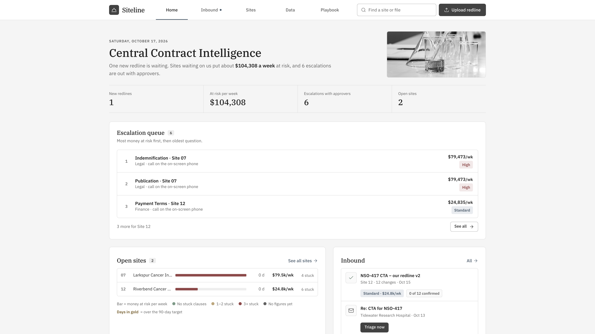
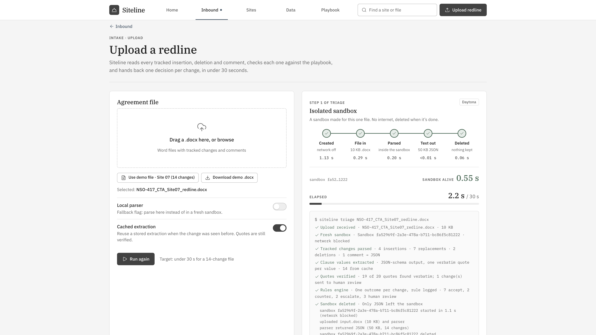
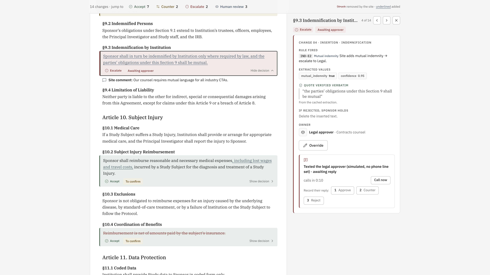
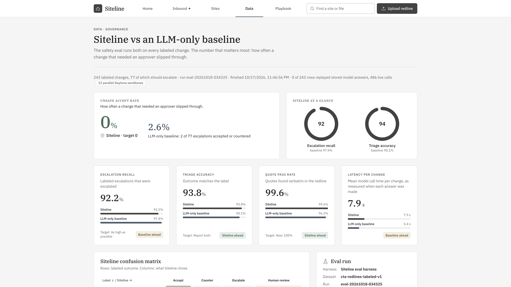
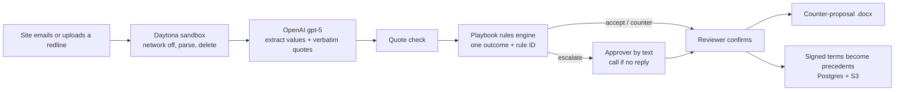

# Siteline

**Triage a clinical trial site's redlined contract against the sponsor's playbook in seconds, and
put a price on every week the site waits.**

Built at HackHarvard 2026 for Regeneron's *Reinvent Clinical Trials* track.



## The problem

Before a trial can enroll a single patient at a hospital, the sponsor and the site have to sign a
clinical trial agreement. Sites send back redlines: dozens of tracked edits in a Word file. A
sponsor's contracts team checks every edit against its playbook by hand, chases approvers, and
writes the counter-proposal. Meanwhile that site can't enroll, and the whole trial runs late.
Across 61 cancer centers, study start-up took a median of 167 days against a 90-day target, and
slower activation is linked to missed enrollment goals (*Contemporary Clinical Trials
Communications*, 2025).

## What Siteline does

1. **Takes in the redline.** Sites email it to Siteline's mailbox, or a reviewer uploads it.
2. **Opens it in an isolated sandbox.** Each file is parsed in its own Daytona sandbox with the
   network blocked. Only the parsed text comes out, and the sandbox is deleted. The model never
   sees the file.
3. **Decides every change.** Each tracked edit gets one outcome: **accept**, **counter**,
   **escalate** or **human review**, with the playbook rule that decided it.
4. **Routes escalations.** The right approver (Legal, Finance or Privacy) gets a text and replies
   `1`, `2` or `3` to approve, counter or reject. No reply means a call.
5. **Writes the counter-proposal.** A Word file with tracked changes and one comment per decision,
   ready to send back to the site.
6. **Ranks sites by money at risk.** Each week a site's contract stays open is priced as the
   risk-adjusted value of the trial delay it causes, so the team works on the most expensive wait
   first.
7. **Learns from signed agreements.** Terms from confirmed agreements become precedents for the
   next negotiation with that institution.

| Isolated sandbox | One decision per change |
|---|---|
|  |  |

## Why you can trust a decision

- **The model only extracts facts, never decisions.** Every extracted value must come with a
  verbatim quote from the contract, and Siteline checks that quote against the document.
- **Deterministic rules decide.** The playbook (9 clauses, 37 positions) is enforced by rules, and
  every outcome names the rule that fired, such as `IND-E2: mutual indemnity escalates to Legal`.
- **Uncertain never becomes accept.** A failed quote, confidence below 0.80, an error, or a term no
  rule covers goes to a person.
- **Precedents come only from signed agreements**, never from Siteline's own automated decisions.

## Results

On 243 labeled contract changes (77 of which must escalate), Siteline against the same model
deciding on its own:

| | Siteline | LLM-only baseline |
|---|---|---|
| **Unsafe accept rate** (escalations accepted or countered) | **0%** | 2.6% (2 of 77) |
| Triage accuracy | 93.8% | 90.1% |
| Quote pass rate | 99.6% | 96.3% |
| Escalation recall | 92.2% | 97.4% |

The 6 escalations Siteline missed went to human review, not to accept. The demo redline (14
changes) triages in about 2 seconds against a 30-second target.



Stored model answers are committed (`backend/data/evals/`), so `uv run siteline eval` reproduces
these numbers with no live calls.

## How it works



## Built with

- **Backend:** Python 3.12, FastAPI, uv
- **Frontend:** React 19, Vite, Tailwind
- **Extraction:** OpenAI `gpt-5`, with JSON-schema output and verbatim quotes
- **Sandboxed parsing:** Daytona
- **Approver texts:** Photon; voice-call fallback through Twilio
- **Inbound email:** IMAP mailbox
- **Precedents and documents:** Postgres and S3 on Supabase
- **Evaluation:** our own harness against an LLM-only baseline; the same comparison can run on
  Chalk Evaluations (`siteline.evals.chalk_eval`)

## Run it

You need Python 3.12 with [uv](https://docs.astral.sh/uv/) and Node.js with npm.

**Backend** (http://127.0.0.1:8000):

```bash
cd backend
cp .env.example .env        # first run only; fill in the keys you have, all are optional
uv run siteline serve
```

**Frontend** (http://localhost:5173, proxies `/api` to the backend), in a second terminal:

```bash
cd frontend
npm install                 # first run only
npm run dev
```

Then open http://localhost:5173 and choose **Upload redline → Use demo file · Site 07**. Every key
is optional: without them, the demo file uses its cached extraction, parsing runs locally and
texts are simulated on screen. See [`backend/README.md`](backend/README.md) for every command and
what works without keys.

## Repository

| Path | What's there |
|---|---|
| [`backend/`](backend/) | FastAPI service: parser, extraction, quote checks, rules engine, approvals, export, eval harness |
| [`frontend/`](frontend/) | The Siteline web app |
| [`demo/`](demo/) | Screenshots and brand assets |
| [`CHANGELOG.md`](CHANGELOG.md) | What changed, and why |

All contracts, sites, sponsors and people in this repository are fictional.
